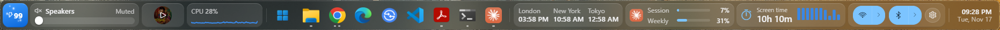
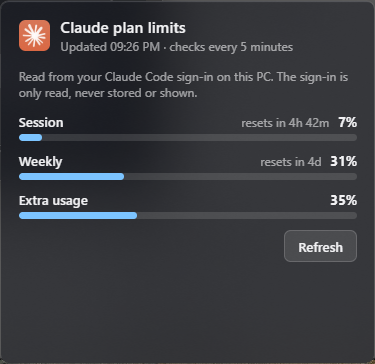
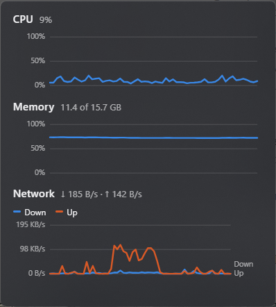
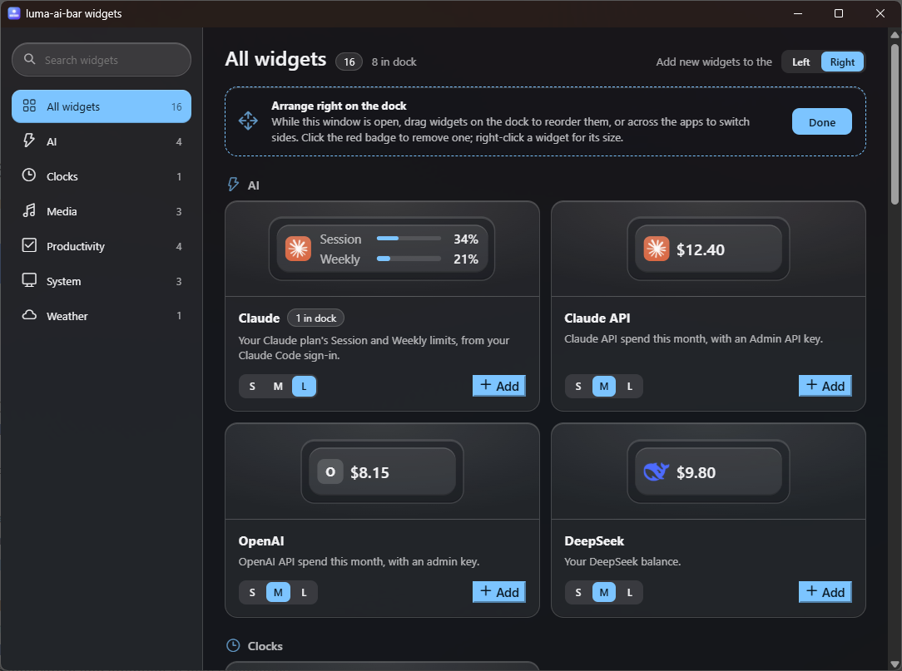
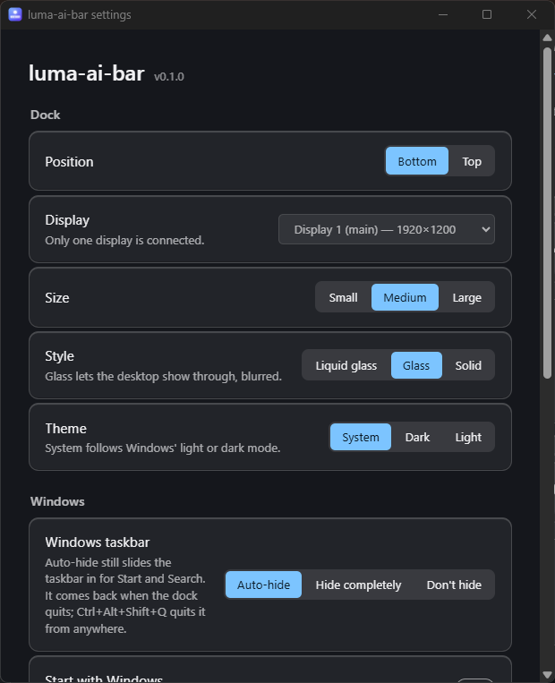

# luma-ai-bar

A dock for Windows 11 that takes the place of the taskbar. Your pinned and open apps sit in the middle; widgets for the system, media, clocks and AI usage sit on either side.



Built with [Tauri 2](https://tauri.app) (Rust + WebView2) and React. It's an independent project: no code or assets come from other dock apps.

## What it does

**Taskbar**
- Pinned apps (imported from your Windows taskbar the first time), running apps, and a dot per open window.
- Live window previews on hover, right-click menus, and a pulsing tile for apps that want attention.
- Start button, a clock, and the Windows taskbar hidden while the dock runs: auto-hide, completely hidden, or left alone.
- Bottom or top of the screen, on any display, in three sizes.

**Widgets**, on the left or right of the apps, in three sizes. Rest the pointer on one to glance at its details, or click to keep them open.

109 widgets in 13 groups:

| | |
|---|---|
| **AI** | Claude, ChatGPT (via Codex CLI) and Gemini CLI plan limits, AI limits side by side, GLM Coding Plan, OpenCode, Claude API and OpenAI spend, DeepSeek, OpenRouter and Kimi balances |
| **System** | CPU, memory and network, top CPU and memory apps, temperature, brightness, four battery looks, Wi-Fi, Bluetooth, hotspot and airplane mode, keyboard language, light or dark, notifications, on-screen keyboard, show desktop, day, month and year progress |
| **Media** | Now playing (four looks), speakers, microphone, wallpaper (with *Next background* for Windows Spotlight and slideshows) |
| **Clocks** | Clock, flip clock, segment clock, analog, world clocks, world time, date, day number, today, clock and weather, 7 days |
| **Weather** | Weather, details, today and forecast, status, hourly, sunrise and sunset |
| **Productivity** | Screen time (synced with Windows' own record), day timeline, to-do, notes, pomodoro, timer, stopwatch, calendar (iCal address), currency, progress |
| **Apps & Files** | Apps, recently opened, search, commands, screenshot, storage, Recycle Bin |
| **Online & Mail** | Wallpaper gallery, mail (IMAP with an app password), GitHub activity, notifications and overview, LeetCode |
| **Finance** | Total revenue, plus Stripe, Polar, Dodo Payments, Shopify, Lemon Squeezy, Paddle and Gumroad, each as a number or a chart |
| **Stocks** | Stock, watchlist, crypto |
| **Analytics, Developer, Social** | Plausible, Dub; Resend, Linear, Supabase; X, YouTube, Instagram |

<p>
  
  
</p>

Add, remove and arrange widgets from the widget picker. While it's open, drag widgets on the dock itself to reorder them or move them across the apps.



**Styles**: Liquid glass (the desktop is refracted through the bar), Glass (blurred), or Solid. Themes follow Windows' light or dark mode, or you can pick one.



## Install

[Download the installer](https://github.com/jeev-jo/lumabar-rea/releases/latest/download/luma-ai-bar_x64.msi) (`.msi`) from the latest release and run it. The app checks GitHub Releases for updates (*Settings → About → Check now*). Every update is signed, and the app refuses one that doesn't match its built-in public key.

Windows may show a SmartScreen warning, because the installer isn't code-signed with a paid certificate.

## Getting your taskbar back

The dock always restores the Windows taskbar when it quits, including after a crash. A small watchdog process puts it back even if the dock is killed.
- **Ctrl+Alt+Shift+Q** quits the dock from anywhere.
- You can also quit from the tray icon.
- If the taskbar is still hidden after something unusual, starting the dock again restores it first.

## Privacy

Everything stays on your PC.
- **API keys** (and app passwords and calendar addresses) for online widgets are encrypted with Windows DPAPI under your account, and only sent to the service they belong to.
- **Claude plan limits** are read from Claude Code's own sign-in file. The token is only read, never stored or shown.
- **Screen time** is counted locally.

Data lives in `%LOCALAPPDATA%\luma_ai_bar`.

## Build from source

You need Node 20+, Rust (stable, MSVC), and the Visual Studio C++ build tools.

Install the dependencies:

```bash
npm install
```

Run the dock in development:

```bash
npm run tauri dev
```

Build the installer:

```bash
npm run tauri build
```

The installer is written to `src-tauri/target/release/bundle/msi/`.

### Releasing an update

Updates are signed with a private key that never goes in the repo.
1. Bump `version` in `src-tauri/tauri.conf.json`.
2. Build with `TAURI_SIGNING_PRIVATE_KEY` set to the path of the key (and `TAURI_SIGNING_PRIVATE_KEY_PASSWORD` if it has one).
3. Run `node scripts/latest-json.mjs "What changed"` to write `latest.json` next to the `.msi`.
4. Make a GitHub release tagged `vX.Y.Z` and attach the `.msi`, its `.sig`, and `latest.json`.
5. Also attach a copy of the `.msi` named `luma-ai-bar_x64.msi`. The website's Download button links to `releases/latest/download/luma-ai-bar_x64.msi`, so it always gets the newest installer.

Installed copies find the new version through `releases/latest/download/latest.json`.
